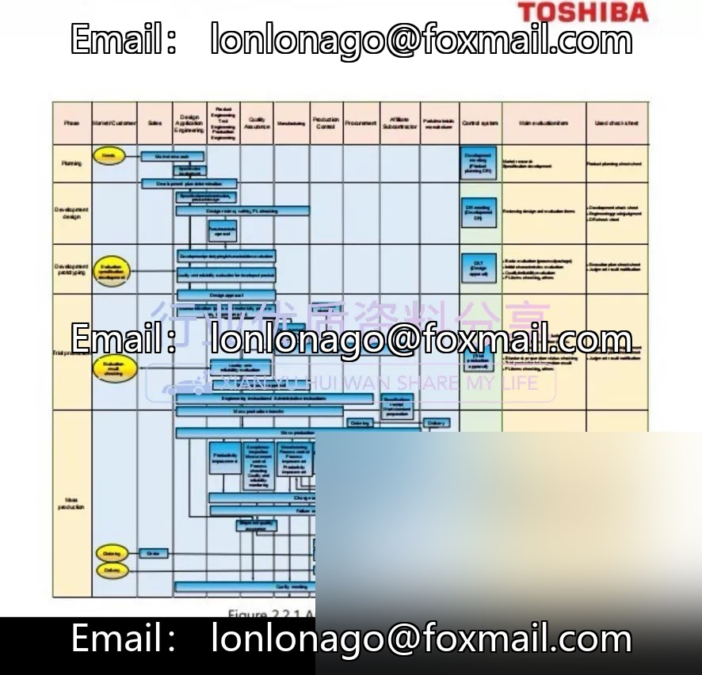
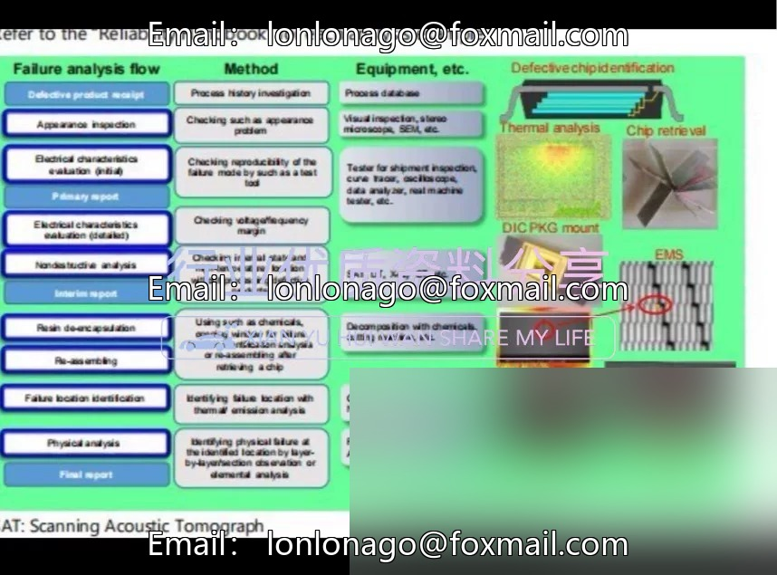
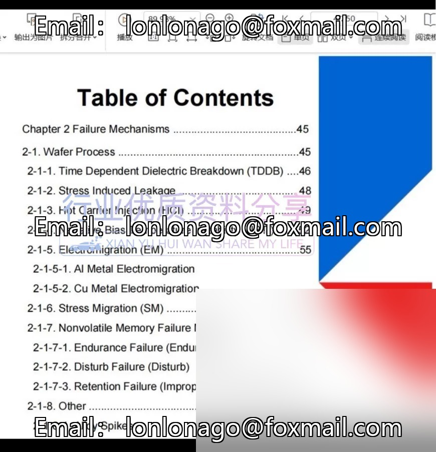
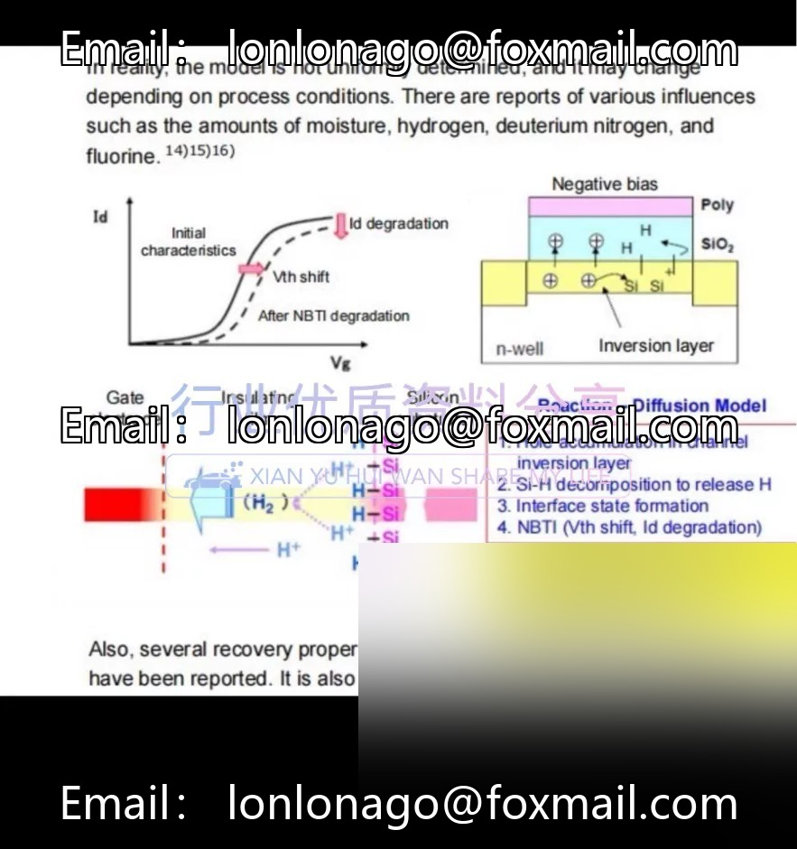
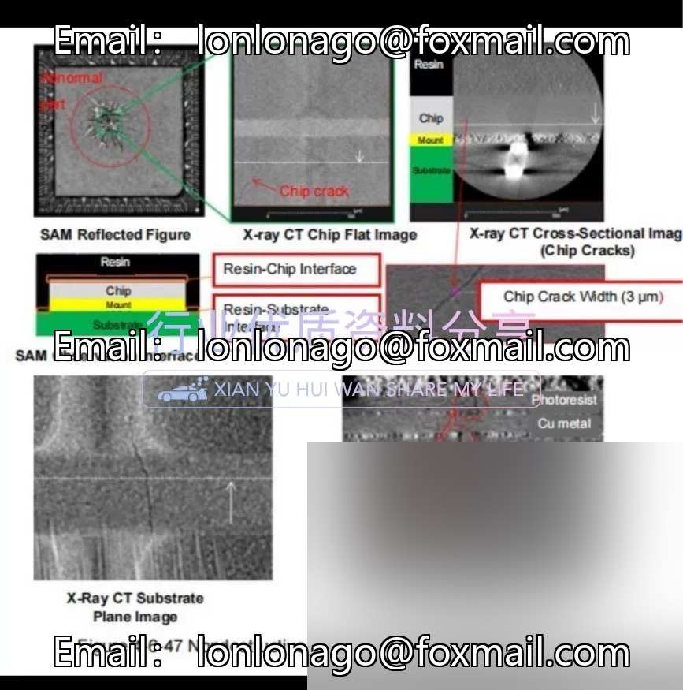
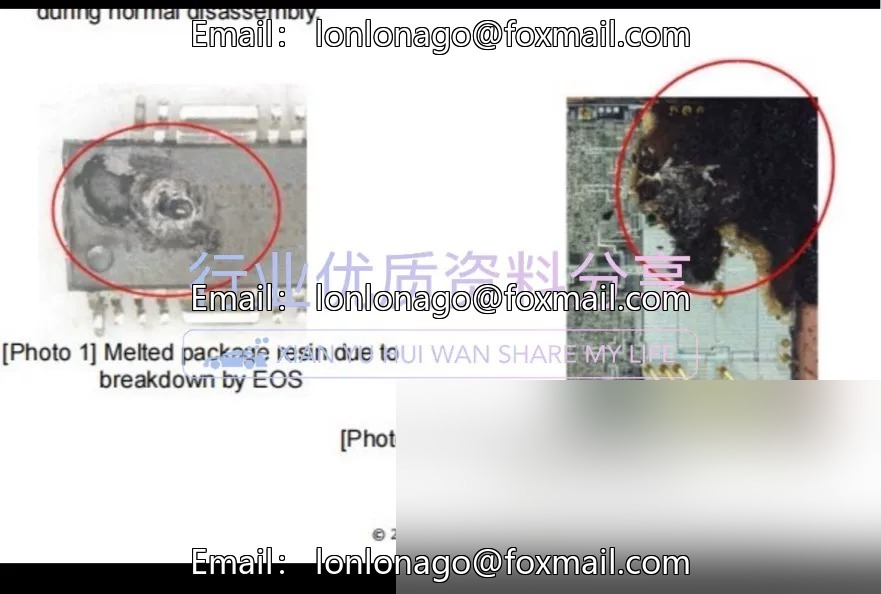
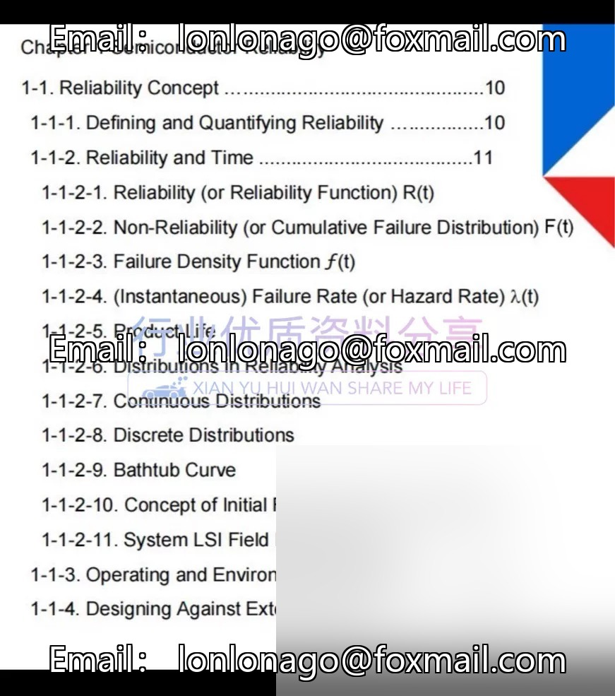

# Semiconductor Quality and Reliability Manual: Internal IE engineer training materials from Toshiba in Japan

## Body

Semiconductor Quality and Reliability Manual: Internal IE Engineer Training Materials from Toshiba in Japan! Full version 250 pages!

Capture and send the electronic original directly! The following images include screenshots of the file portion. Please confirm before placing the order! Due to the replicable nature of electronic documentation Therefore, are allowed after purchase! Thanks for understanding!

For personal learning and reference use only.

This is the internal IE engineer training manual from Toshiba, with a complete version of 250 pages; images show quality analysis, reliability methods and related content.

<!-- AI_ENRICHED -->

## Images

## Payment

Here is a pay link on Stripe ( https://buy.stripe.com/3cs8yP7sY87d0vu9AB ). Please contact me lonlonago@foxmail.com after funding $89, and I will send you a complete data files , thank you!

